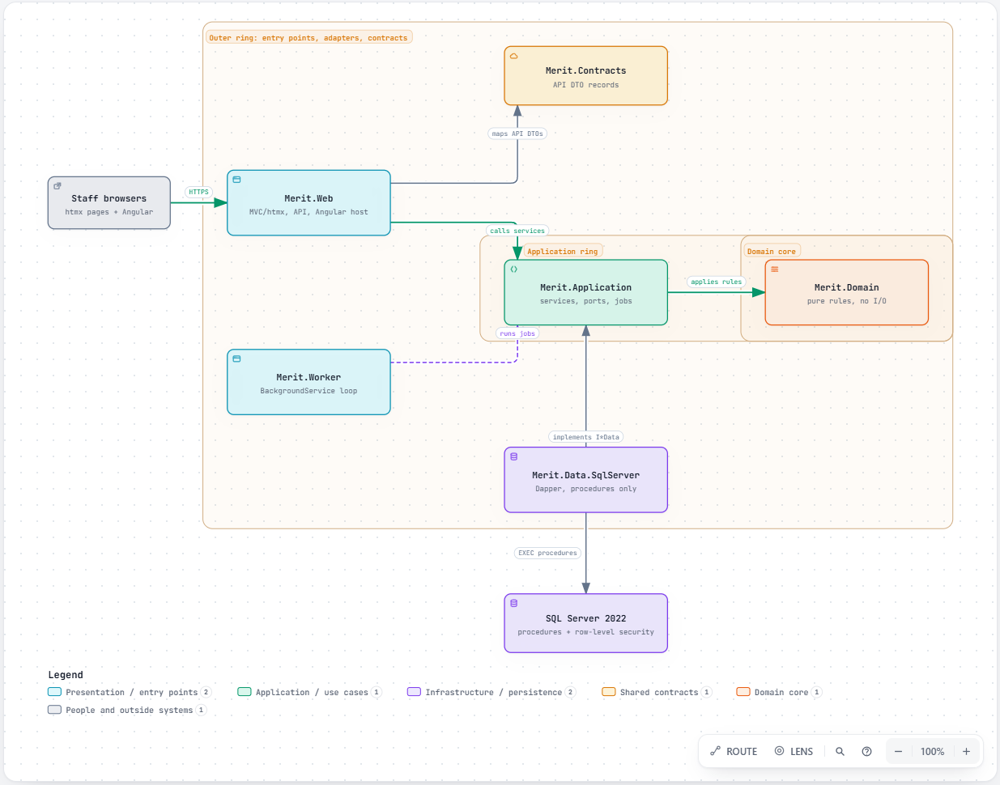

# MERIT: Metals Exposure Registry and Investigation Tracking

MERIT is a web application for public health programs that track exposure to lead and other heavy metals. It takes
in laboratory results, matches them to people, classifies cases, and runs follow-up, investigations and federal
reporting, with each agency seeing only its own records.

-brightgreen)


> The badges are static. There is no CI pipeline yet, so "passing" means the local test run: 86 unit, 22 integration
> and 24 end-to-end tests. Coverage has not been measured.

---

## Overview and motivation

**The problem.** State and local lead programs receive thousands of lab results from many laboratories, in
inconsistent formats. Staff must:
- match each result to the right person,
- decide whether it opens a case under rules that differ for children, adults and pregnant people,
- follow up with families and employers, and
- send de-identified files to CDC and NIOSH.

Surveys of these programs report the same pain points: manual matching, no geocoding, slow follow-up, and agencies
seeing more (or less) than they should.

**Who it is for.**
- Intake specialists, case managers and investigators at state, county and tribal health agencies.
- Epidemiologists and program supervisors.
- Administrators who manage access across a region, state and its counties.

**Key features.**
- **Intake that fixes causes, not rows.** Files are parsed, validated and matched. Held records are grouped by cause,
  and urgent results sort first.
- **Person matching review.** Candidates are compared field by field ("Jon" vs "Jonathan", day and month swapped,
  possible twins). The screen is keyboard-driven, and "different person" decisions are remembered.
- **Case classification.** Rules cover the CDC reference value, the child capillary-confirmation window, adult and
  pregnancy rules, and detection limits.
- **Work queues and investigations:**
  - person timelines,
  - a case map,
  - cluster review,
  - residential and workplace investigations.
- **Reports and federal extracts.** Testing counts, case timeliness, reporter completeness, CBLS and ABLES extracts,
  and CSV or Excel export.
- **Hierarchical access:**
  - **Tenant tree:** platform, then region, state or tribe, then jurisdiction.
  - **Master and personal profiles:** each user's master profile is what administrators gave them; users can make
    smaller profiles and switch between them.
  - **View-as:** administrators can see another user's access, limited to what they themselves manage.
  - **Row-level security:** SQL Server enforces it, including read-only and no-delete access levels.
- **Accessible and secure by default:**
  - USWDS styles,
  - WCAG 2.1 AA checked with axe,
  - Content Security Policy with nonces,
  - TOTP multi-factor authentication,
  - every view, change and export audited.



Interactive diagrams:

| Diagram | What it shows |
| --- | --- |
| [Architecture rings](docs/merit_architecture.html) | The Clean Architecture rings and the direction of dependencies |
| [Codebase inspection](docs/codebase_inspection.html) | Project references, plus the synchronous web path and the asynchronous worker path |
| [Data-flow workflows](docs/data-flow_workflows.html) | A request and a background job, step by step through the layers |
| [Daily intake workflow](docs/daily-intake_workflow.html) | A laboratory file from upload to loaded, held or match review, then to a case and its tasks |
| [NPI and CLIA import](docs/npi-clia-import_workflow.html) | Loading the reporter registry from a CSV file: check, fix, import, release |
| [CBLS extract lifecycle](docs/cbls-extract_lifecycle.html) | A quarterly CDC extract run from request to submitted |

User guides (PDF, with the HTML sources in `docs/guides/`):

| Guide | For |
| --- | --- |
| [Daily operations](docs/MERIT%20User%20Guide%20-%20Daily%20Operations.pdf) | Daily, weekly and quarterly work: intake, held records, match review, manual entry, cases, investigations, reports, federal extracts |
| [Importing NPI and CLIA records](docs/MERIT%20User%20Guide%20-%20Importing%20NPI%20and%20CLIA%20Records.pdf) | Keeping the laboratory, facility and provider registry current |
| [Access and profiles](docs/MERIT%20User%20Guide%20-%20Access%20and%20Profiles.pdf) | Who sees what, profiles, view as, and who can add tenants |

---

## Prerequisites and tech stack

| Need | Version | Notes |
| --- | --- | --- |
| .NET SDK | 9.0.200 or later | `global.json` rolls forward. The projects target `net9.0`. |
| Visual Studio 2022 | 17.12 or later | Optional. Opens `sourceCode/Merit.sln`, including the "Web + Worker" launch profile. |
| SQL Server | 2022 (major version 16) or later | Developer or Express edition is fine. A SQL Server container also works. |
| `sqlcmd` | ODBC sqlcmd 15+ or go-sqlcmd | Used by the deployment script. |
| PowerShell | Windows PowerShell 5.1 or PowerShell 7 | Runs `Deploy-MeritDatabase.ps1`. |
| Node.js and npm | Node 20 or later | Builds the Angular client and runs the end-to-end tests. The server-rendered pages work without it. |
| Python | 3.11 or later | Optional. Only needed to regenerate SQL scripts from `database/tools/*.py`. |
| Microsoft Edge | Current | Used by the Playwright end-to-end tests (no browser download needed). |

**Stack:**
- **Server:** ASP.NET Core 9 MVC with Razor views and htmx 4 (server-rendered screens), a JSON API under `/api/v1`,
  and Angular 22 for data-heavy screens.
- **Data access:** Dapper calling stored procedures only, on SQL Server 2022 with row-level security.
- **Background work:** a .NET worker service that runs queued jobs.

**No external API credentials are needed.** MERIT runs entirely on your machine with synthetic demo data.

---

## Installation and setup

```powershell
# 1. Get the code
git clone <your-repository-url> merit
cd merit\sourceCode

# 2. Trust the local HTTPS certificate
dotnet dev-certs https --trust

# 3. Create the database, logins and demo data (safe to re-run)
cd database
$web    = Read-Host -AsSecureString 'Password for the meritWeb login'
$worker = Read-Host -AsSecureString 'Password for the meritWorker login'
.\Deploy-MeritDatabase.ps1 -ServerInstance 'localhost\PORTAL' -CreateLogins `
    -WebLoginPassword $web -WorkerLoginPassword $worker -IncludeDemoData
cd ..

# 4. Give the web app and worker their connection strings (kept out of source control)
dotnet user-secrets --project src/Merit.Web    set "ConnectionStrings:Merit" "Server=localhost\PORTAL;Database=MERIT;User ID=meritWeb;Password=<web password>;Encrypt=True;TrustServerCertificate=True"
dotnet user-secrets --project src/Merit.Worker set "ConnectionStrings:Merit" "Server=localhost\PORTAL;Database=MERIT;User ID=meritWorker;Password=<worker password>;Encrypt=True;TrustServerCertificate=True"

# 5. Restore and build (the first build also installs and builds the Angular client)
dotnet build Merit.sln
```

For a real installation, leave out `-IncludeDemoData`. Instead, create the first platform administrator:

```powershell
$admin = Read-Host -AsSecureString 'First platform administrator password'
.\Deploy-MeritDatabase.ps1 -ServerInstance 'yourServer' -PlatformAdminUserName 'platformadmin' -PlatformAdminPassword $admin
```

**Environment variables instead of user secrets.** ASP.NET Core reads `__` as a section separator. A `.env`-style
example:

```bash
ConnectionStrings__Merit="Server=localhost\PORTAL;Database=MERIT;User ID=meritWeb;Password=...;Encrypt=True;TrustServerCertificate=True"
ASPNETCORE_ENVIRONMENT=Development
DataProtection__KeyPath=C:\merit\keys
Session__IdleTimeoutMinutes=20
```

---

## Usage and quickstart

The shortest path is to open `sourceCode/Merit.sln` in Visual Studio, pick the **Web + Worker** launch profile and
press F5.

From a terminal:

```powershell
cd sourceCode
dotnet run --project src/Merit.Worker      # terminal 1: background jobs, http://localhost:5280/health
dotnet run --project src/Merit.Web         # terminal 2: https://localhost:7243
```

1. Sign in at https://localhost:7243. Every demo user's password is `MeritDemo!2026`.
2. Enroll an authenticator app at first sign-in.
3. Try these:

| Try this | Sign in as |
| --- | --- |
| Upload `samples/chesapeake_lab_sample.csv` on **Intake**, then work **Held records** | `intake` |
| Upload `samples/chesapeake_match_review_sample.csv`, then open **Match review** (keys 1–5, S, D, N, J, K) | `supervisor` |
| See cases, the **Map**, **Clusters** and **Reports** | `supervisor` |
| See only one county's records | `cmbalt` (Baltimore City) or `cmbaltco` (Baltimore County) |
| Work across two counties, then make a read-only profile under **Profile** in the header | `cmboth` |
| Administer one county and **View as** its staff | `cityadmin` |
| Load `samples/registry_npi_clia_sample.csv` on **Reporters > Import NPI and CLIA records** | `supervisor` |
| Generate a CBLS file on **Extracts**, view its findings, then **Mark submitted** | `supervisor` |
| Add a county health department or program on **Tenants** | `admin` |
| Manage accounts only, with no records visible; add regions, states and tribes on **Tenants** | `platform` |

---

## Configuration

**`appsettings.json` keys (Merit.Web and Merit.Worker):**

| Key (environment variable) | Default | Used by | Meaning |
| --- | --- | --- | --- |
| `ConnectionStrings:Merit` (`ConnectionStrings__Merit`) | placeholder | Web, Worker | SQL Server connection. Web uses the `meritWeb` login; Worker uses `meritWorker`. Both are EXECUTE-only. |
| `Session:IdleTimeoutMinutes` | `20` | Web | Sign-out after inactivity. |
| `DataProtection:KeyPath` | app data folder | Web | Where ASP.NET Core data-protection keys are kept. They protect MFA secrets and cookies, so share them across web servers. |
| `Merit:SignInAttemptsPerMinute` | `30` | Web | Password attempts allowed per client address in any minute. Over the limit the client sees a **Too many attempts** page (HTTP 429 with `Retry-After`). Other clients are not affected, and repeated wrong passwords still lock the account after 5 tries. |
| `Merit:MfaAttemptsPerMinute` | `30` | Web | The same limit for the authenticator-code and enrollment steps, counted separately. |
| `Merit:ForwardedHeaders:KnownProxies` | empty | Web | Addresses of reverse proxies whose `X-Forwarded-For` is trusted. Set it behind a proxy or load balancer, or every client shares the proxy's address and its limit. |
| `Urls` | `http://localhost:5280` | Worker | Health endpoints `/health` and `/health/queues`. |
| `Worker:PollSeconds` | `2` | Worker | How often the worker looks for queued jobs. |
| `Worker:ClusterDetection:RunAsUserName` | empty (off) | Worker | Account that scheduled cluster detection runs as. |
| `Worker:ClusterDetection:IntervalHours` | `24` | Worker | How often cluster detection runs. |

Program settings such as levels, case definitions and extract options are kept per state in the database. Change them
on the **Configuration** screens.

**`Deploy-MeritDatabase.ps1` flags:**

| Flag | Meaning |
| --- | --- |
| `-ServerInstance`, `-DatabaseName` | Target server and database. The defaults are `localhost\PORTAL` and `MERIT`. |
| `-SqlCredential` | Use SQL authentication instead of Windows authentication. |
| `-CreateLogins`, `-WebLoginPassword`, `-WorkerLoginPassword` | Create the application logins if they don't exist. |
| `-IncludeDemoData` | Load the synthetic Maryland demo. Never use it in production. |
| `-PlatformAdminUserName`, `-PlatformAdminPassword` | Create the first platform administrator. Only the password hash reaches SQL Server. |

**Test settings:**

| Variable | Meaning |
| --- | --- |
| `MERIT_IT_SERVER`, `MERIT_IT_DATABASE`, `MERIT_IT_WEB_PASSWORD`, `MERIT_IT_SKIP_DEPLOY` | Integration test server and database (the default database is `MERIT_IT`). |
| `MERIT_E2E_URL`, `MERIT_E2E_SERVER`, `MERIT_E2E_DATABASE`, `MERIT_E2E_CHANNEL` | End-to-end test target and browser. |
| `Merit__SignInAttemptsPerMinute`, `Merit__MfaAttemptsPerMinute` | Set on the web app (not the test runner) to raise the sign-in limits when end-to-end runs are repeated in quick succession from one machine. The integration tests set their own limits. |

---

## Architecture and project structure

MERIT follows Clean Architecture. The domain rules depend on nothing, and the outer layers point inward.

```
merit/
├── README.md                  ← this file
├── docs/
│   ├── requirements/          specification, architecture requirements, screen mock-ups
│   ├── merit_architecture.html, codebase_inspection.html, data-flow_workflows.html   interactive diagrams
│   ├── daily-intake_workflow.html, npi-clia-import_workflow.html, cbls-extract_lifecycle.html   user workflow diagrams
│   ├── MERIT User Guide - Daily Operations.pdf
│   ├── MERIT User Guide - Importing NPI and CLIA Records.pdf
│   ├── MERIT User Guide - Access and Profiles.pdf
│   ├── images/guide/          screenshots and diagram images used by the guides
│   └── guides/                HTML sources of the user guides (printed to PDF)
├── sourceCode/
│   ├── Merit.sln              solution (Web + Worker launch profile in Merit.slnLaunch)
│   ├── README.md              detailed developer notes
│   ├── src/
│   │   ├── Merit.Domain/          BUSINESS RULES: classification, population, thresholds, matching, residence
│   │   ├── Merit.Application/     USE CASES: services, permission checks, intake and job processing, data ports (I*Data)
│   │   ├── Merit.Contracts/       API request and response records shared with the Angular client
│   │   ├── Merit.Data.SqlServer/  Dapper adapters for the ports; every call is a stored procedure
│   │   ├── Merit.Web/             ROUTES: Controllers/ (htmx pages), Controllers/Api/ (/api/v1), Views/, ClientApp/ (Angular)
│   │   └── Merit.Worker/          background jobs: intake batches, federal extracts, cluster detection
│   ├── database/
│   │   ├── Deploy-MeritDatabase.ps1   re-runnable deployment
│   │   ├── scripts/               generated SQL (tables, row-level security, procedures, seed, demo)
│   │   └── tools/                 Python generators for those scripts
│   ├── samples/               synthetic lab files to try intake and matching
│   └── tests/
│       ├── Merit.Tests/           unit, architecture and endpoint-inventory tests
│       ├── Merit.IntegrationTests/ pages, APIs, cross-tenant and authorization scenarios on real SQL Server
│       └── e2e/                   Playwright and axe: keyboard flows and WCAG 2.1 AA
├── tracking/                  task list and progress spreadsheet
└── journal/                   Claude Code usage log
```

**Rules the architecture tests enforce:**
- Controllers never touch data access.
- The Application layer knows no database or web types.
- The Domain layer has no dependencies.

---

## Testing and linting

```powershell
cd sourceCode
dotnet test tests/Merit.Tests                 # unit, architecture, endpoint inventory (no database needed)
dotnet test tests/Merit.IntegrationTests      # deploys MERIT_IT, then pages, APIs, cross-tenant and authorization scenarios
dotnet test Merit.sln                         # both of the above

cd tests/e2e                                  # needs MERIT running (see Usage) with the demo data
npm install
npx playwright test                           # keyboard-only flows and axe WCAG 2.1 AA at tablet width
```

**Linting and static checks:**
- **C#:** `TreatWarningsAsErrors` and the .NET analyzers are on for every project (`Directory.Build.props`), so
  `dotnet build` fails on any warning.
- **Angular:** `strict` TypeScript and `strictTemplates`. Build with `cd src/Merit.Web/ClientApp`, then `npm run build`.
- **SQL:** the convention gate checks naming, headers, audit columns and descriptions. Run it from the repository
  root: `python .claude/hooks/validate-sql.py sourceCode/database/scripts`.

---

## Contributing

1. Fork the repository, or create a branch if you have write access.
2. Name branches by type and task, such as `feature/T108-match-review`, `fix/search-duplicate-rows` or
   `docs/access-guide`. Task IDs come from `tracking/tasks.json`.
3. Change the SQL generators in `sourceCode/database/tools/`, not the generated scripts. Then regenerate the scripts
   and re-run the deployment twice; it must be clean both times.
4. Keep the layering: rules in Domain, orchestration and permission checks in Application, I/O in Data, and thin
   controllers.
5. Before opening a pull request:
   - `dotnet build` has no warnings,
   - `dotnet test Merit.sln` passes,
   - `npx playwright test` passes for UI changes,
   - the SQL convention gate passes.
6. In the pull request, describe what changed and why, link the task, and include screenshots for UI changes. Ask
   for at least one review before merging.

A separate `CONTRIBUTING.md` can expand on this when the project opens to outside contributors.

---

## License and acknowledgments

**License:** [Apache License 2.0](LICENSE). Anyone may use, modify and distribute it, including commercially. It comes
with no warranty, and redistributions must keep the copyright notice and the project's [NOTICE](NOTICE) file, which
credits the source.

**Built with:**
- **Server and data:**
  - ASP.NET Core 9,
  - Dapper,
  - Microsoft.Data.SqlClient,
  - SQL Server 2022,
  - QRCoder (authenticator QR codes).
- **Front end:**
  - htmx 4,
  - the U.S. Web Design System (USWDS) 3,
  - Angular 22 and the Angular CDK,
  - RxJS.
- **Testing:**
  - xUnit,
  - NetArchTest,
  - Playwright,
  - axe-core.
- **Diagrams:** Archify.
- **Guidance:**
  - the CDC blood lead reference value and the CSTE case definitions,
  - NIOSH ABLES and CDC CBLS layouts,
  - NIST SP 800-63B-4 (authentication).
- **Development:** built with Claude Code.

All people, addresses and results in the demo data and samples are synthetic.
