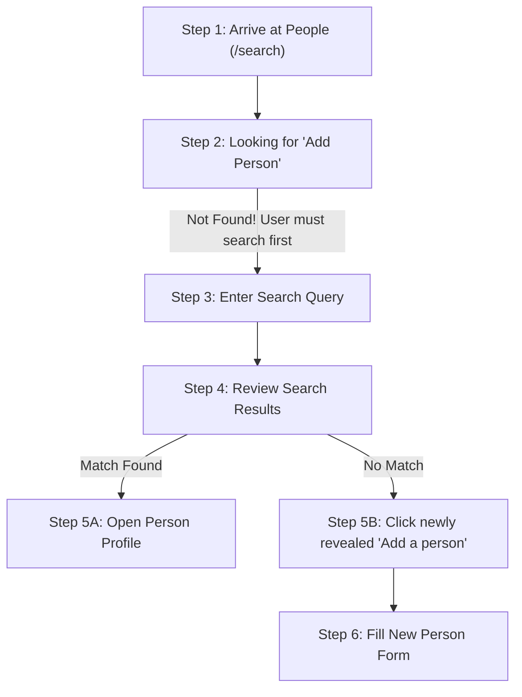
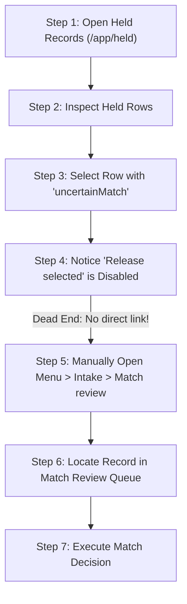

# MERIT: Comprehensive Web Application UX, Usability, and Workflow Audit

**Auditor:** Senior UX/UI Designer, Usability Researcher, Human-Computer Interaction (HCI) Specialist, and Web Accessibility Expert  
**Date of Audit:** November 2, 2026  
**Evaluation Scope:** MERIT Web Application (ASP.NET Core 9 MVC, Razor Views, htmx 4, Angular 22 SPA, USWDS 3.14.0)  
**Evaluation Mode:** Evaluation-Only Assignment (Non-destructive inspection, real application testing via Playwright automation, zero persistent data mutation)  

---

## A. Executive Summary

### 1. Overall Usability Assessment
MERIT (Metals Exposure Registry and Investigation Tracking) is an enterprise-grade public health software platform engineered with exceptional technical discipline. It features clean architecture, rigorous row-level data segregation, deterministic surveillance rules (CDC reference values, blood lead capillary-confirmation windows), and automated compliance with WCAG 2.1 AA standards (zero automated axe-core violations across 22 evaluated screens).

However, **when evaluated strictly from the perspective of an untrained, first-time user**, the user experience breaks down significantly across several core operational workflows. The application currently assumes extensive prior institutional domain knowledge, familiarity with internal software architecture, and tolerance for fragmented multi-step procedures. Primary creation actions are frequently obscured, navigation patterns vary abruptly between direct links and disclosure submenus, and workflows require high cognitive recall rather than intuitive recognition.

### 2. Major Strengths
- **Design System Consistency:** Faithful implementation of the U.S. Web Design System (USWDS 3.14.0), providing clean typography, standardized form controls, accessible color contrast ratios, and clear responsive typography.
- **Automated Accessibility Foundations:** Zero automated violations under axe-core (`wcag2a`, `wcag2aa`, `wcag21a`, `wcag21aa`, `wcag22aa`) across all tested views. Focus styles and screen-reader status announcements (`role="status"`, `aria-live="polite"`) are well-placed.
- **Fail-Safe Clinical & Privacy Safeguards:** Deterministic matching algorithms prevent erroneous master person merging; sensitive patient identifiers (PID-3) are strictly stripped from general result snapshots; and row-level security prevents unauthorized cross-jurisdiction access.
- **Responsive In-Place Data Morphing:** Rapid table filtering and sorting powered by server-rendered htmx `innerMorph` preserves scroll position and input focus without disruptive full-page flashes.

### 3. Major Weaknesses
- **Complete In-App Help Absence:** Despite the existence of 50+ pages of detailed PDF and HTML user guides in the project repository, there is **no link to user documentation, tutorials, or help anywhere in the application interface**.
- **Hidden Creation Affordances:** Critical capabilities—such as "Add a Person"—are completely hidden from the initial screen and only appear dynamically after a user executes an explicit search query.
- **Disconnected Subsystem Transitions:** Core workflows that naturally follow one another (such as identifying an uncertain person match on Held Records and resolving it in Match Review) are disconnected, offering no direct action links between dependent screens.
- **High Physical & Cognitive Shortcut Burden:** Decision-making in Match Review requires cumbersome tri-key chords (`Alt+Shift+S`, `Alt+Shift+D`, `Alt+Shift+C`), creating physical friction and cognitive hesitation.
- **Obscured User Role & Jurisdiction Controls:** Switching working jurisdictions or user profiles is anchored to a text link styled as an informational label (`Profile: Master profile`), hiding essential multi-county functionality from first-time users.

### 4. Most Significant Workflow Problems
1. **The "Add a Person" Trap:** Users arriving at "Find or add a person" cannot find any button to add a person until they guess that they must first submit an initial search query.
2. **Held Records to Match Review Dead-End:** Held records awaiting patient identity resolution disable their release action with a warning, but provide no link or button to navigate to the matching queue.
3. **Investigation Request Bottleneck:** In Case Management, the "Request an investigation" action is disabled if the patient lacks an address, but provides no inline link or shortcut to add the missing address.
4. **Dual Conflicting Search Bars:** On `/search`, users are confronted with two identical "Search" input fields and two identical "Search" buttons within the same viewport.

### 5. Most Important Opportunities for Improvement
- Unify global navigation into a predictable top bar with consistent dropdown affordances.
- Add a persistent "Help & User Guide" menu linking directly to the comprehensive user documentation.
- Implement actionable contextual deep links across held intake rows, case investigation requests, and person management forms.
- Transform the subtle header profile text into an explicit, recognizable "Switch Jurisdiction / Profile" user component.
- Implement roving tabindex navigation for SVG map points to eliminate hundreds of redundant tab stops for keyboard users.

### 6. Areas Requiring Additional Testing
- Empirical user testing with actual county health department nurses, intake specialists, and epidemiological supervisors under real-world clinical caseload pressures.
- Full screen-reader testing (JAWS, NVDA, VoiceOver) during complex multi-form htmx swaps and Angular route transitions.

---

## B. Workflow Inventory

The audit evaluated the complete lifecycle of 11 primary user workflows across five distinct user roles:

| Workflow ID | Workflow Name | Target User Roles | Entry Point | Primary Steps | Expected Outcome | Evaluated Usability Concern | Testing Status |
| :--- | :--- | :--- | :--- | :--- | :--- | :--- | :--- |
| **WF-01** | **Authentication & MFA Enrollment** | All Users | `/account/signin` | 1. Enter credentials<br>2. Scan QR / Enter secret<br>3. Verify TOTP<br>4. Save recovery codes | Authenticated session with MFA security | No "Forgot Password" link; checkbox styling masks clickable target | **Verified** |
| **WF-02** | **Laboratory File Intake & Triage** | Intake Specialist, Supervisor | `/intake` | 1. Select sender profile<br>2. Upload file<br>3. Inspect batch card<br>4. Diagnose paused/held batches | Raw lab file ingested, validated, and staged | Repository file path exposed in UI text; batch cards lack progress animation | **Verified** |
| **WF-03** | **Held Record Remediation** | Intake Specialist, Supervisor | `/app/held` | 1. Filter by cause/batch<br>2. Select affected rows<br>3. Apply single/group correction<br>4. Release or reject | Held rows corrected and re-validated into master registry | Disabled release on match holds lacks direct link to Match Review | **Verified** |
| **WF-04** | **Person Matching Review** | Intake Specialist, Supervisor | `/app/match-review` | 1. Select queue item<br>2. Compare incoming vs candidates<br>3. Inspect history<br>4. Submit match decision | Incoming test result linked to correct person or new person created | Heavy `Alt+Shift+*` tri-key shortcuts; sequential candidate elimination friction | **Verified** |
| **WF-05** | **Person Search & Profile Management** | Case Manager, Investigator | `/search`, `/people/:id` | 1. Search name/DOB<br>2. View demographics & cases<br>3. Add address/job/source<br>4. Enter manual result | Complete longitudinal record maintained | "Add a Person" hidden until search submitted; dual search bars on `/search` | **Verified** |
| **WF-06** | **Case Follow-up & Task Management** | Case Manager, Investigator | `/cases`, `/cases/:id`, `/app/queues` | 1. Select case from queue<br>2. Track confirmation window<br>3. Log activity<br>4. Assign/complete task | Case resolved within public health timeliness standards | "Request Investigation" disabled without inline navigation to add missing place | **Verified** |
| **WF-07** | **Environmental Field Investigation** | Environmental Investigator | `/investigations`, `/investigations/:id` | 1. Review target place<br>2. Schedule visit<br>3. Record samples (XRF/paint/dust)<br>4. Log abatement/clearance | Environmental hazards identified and mitigated | Dense multi-column sample table; sample import format hidden in `<details>` | **Verified** |
| **WF-08** | **Geospatial Surveillance & Clusters** | Epidemiologist, Supervisor | `/app/map`, `/app/clusters` | 1. Filter by analyte/date<br>2. Pan/zoom SVG map<br>3. Inspect point details<br>4. Review cluster alerts | Geographic clusters and elevated cases detected | 200+ individual SVG points pollute sequential tab order | **Verified** |
| **WF-09** | **Federal Extract Lifecycle (CBLS/ABLES)** | Program Supervisor, Epidemiologist | `/extracts` | 1. Request quarterly file<br>2. Review validation errors<br>3. Remediate findings<br>4. Download & mark submitted | De-identified federal extract submitted to CDC/NIOSH | Native browser `window.confirm` used for submission; unlinked findings | **Verified** |
| **WF-10** | **Reporters Registry & NPI/CLIA Import** | Supervisor, System Admin | `/reporters`, `/reporters/import` | 1. Download CSV template<br>2. Upload file for dry-run check<br>3. Review errors<br>4. Commit import | Facilities, labs, and providers synchronized | Page remains on import wizard after success; lacks direct return to directory | **Verified** |
| **WF-11** | **Jurisdiction Admin & Profile Switching** | County/State Admin, Platform Admin | `/admin/users`, `/profiles` | 1. Manage user grants<br>2. Unlock account/Reset MFA<br>3. Switch working jurisdiction | User access restricted to authorized geographic scope | Profile switching link disguised as plain text status badge in header | **Verified** |

---

## C. Cognitive Walkthrough Results

### Detailed Walkthrough 1: Finding or Adding a Person (WF-05)
*User Objective:* A local health department intake clerk receives a paper blood lead lab report from a clinic via fax and needs to enter it for a child who may or may not already be in MERIT.



- **Step 1: Arrive at People Screen (`/search`)**
  1. *Goal recognition:* Yes. User understands they need to find or enter the patient.
  2. *Action discoverability:* **Poor.** The user sees two identical search inputs: one in the global header and one in the main body.
  3. *Control recognition:* Moderate. The search box is clear, but there is no button to add a person.
  4. *Action-result association:* Yes. User expects typing and pressing Search will search the registry.
  5. *Feedback comprehension:* Yes.
  6. *Progress awareness:* Moderate.
  7. *Error recovery:* Yes.
  8. *Next-step clarity:* **Poor.** If the user already knows this is a newborn or someone never tested before, they search the screen for an "Add Person" button and find nothing.
  - *Breakdown Point:* The user hesitates because the primary action ("Add a person") is invisible.

- **Step 2: Submitting an Initial Search Query**
  1. *Goal recognition:* User enters the name from the fax (e.g., "Rivera, Mia") to verify.
  2. *Action discoverability:* Good. User presses Enter or clicks "Search".
  3. *Control recognition:* Good.
  4. *Action-result association:* High.
  5. *Feedback comprehension:* High. Search results appear via htmx `_Results.cshtml`.
  6. *Progress awareness:* High.
  7. *Error recovery:* High.
  8. *Next-step clarity:* **Moderate.** Below the results table, the button `<a class="usa-button usa-button--outline" href="/people/new">Add a person</a>` has now appeared. If the user had not submitted a query, this button remained unreachable.

---

### Detailed Walkthrough 2: Remedying a Held Match Record (WF-03 to WF-04)
*User Objective:* An intake specialist reviews batch holds and resolves a patient whose demographic details are slightly ambiguous.



- **Step 1: Inspect Held Records (`/app/held`)**
  1. *Goal recognition:* High. User sees "Held records" and summary of causes.
  2. *Action discoverability:* Good. User selects a group or clicks a held row.
  3. *Control recognition:* Good.
  4. *Action-result association:* High.
  5. *Feedback comprehension:* High.

- **Step 2: Attempting to Release a Held Record**
  1. *Goal recognition:* User wants to release the held row.
  2. *Action discoverability:* **Critical breakdown.** The row has reason `uncertainMatch`. The "Release selected" button is disabled.
  3. *Control recognition:* User reads note: *"Decide the match first: releasing does not choose a person, so the row would be held again."*
  4. *Action-result association:* User understands why it cannot be released.
  5. *Feedback comprehension:* High.
  6. *Progress awareness:* Moderate.
  7. *Error recovery:* **Poor.** The application provides no button or hyperlink to take the user to Match Review for this row.
  8. *Next-step clarity:* **Critical failure.** The user must abandon the screen, locate "Match review" under the "Intake" navigation disclosure, and hunt for the record in a queue of up to 200 items.

---

### Detailed Walkthrough 3: Requesting an Environmental Investigation (WF-06 to WF-07)
*User Objective:* A case manager reviews an elevated blood lead case (child BLL 18 µg/dL) and initiates a home environmental investigation.

- **Step 1: Case Detail Workspace (`/cases/:id`)**
  1. *Goal recognition:* High. User navigates to the child's case and scrolls to "Investigations".
  2. *Action discoverability:* **Poor.** The button "Request an investigation" is disabled (`disabled="true"`).
  3. *Control recognition:* Below the button, text reads: *"Add an eligible place or employer to the person record before requesting an investigation."*
  4. *Action-result association:* User understands an address is required.
  5. *Feedback comprehension:* High.
  6. *Progress awareness:* Poor.
  7. *Error recovery:* **Critical breakdown.** There is no link or shortcut to add an address. The user must scroll to the top summary, click the child's name, navigate to the Person profile, find the Places section, click "Add a place", enter and save the address, return to Cases, search for the case number again, and re-open the case.

---

## D. Detailed Usability Findings

The audit identified 14 distinct usability and accessibility findings across the application. Each finding is classified as **Verified** (observed directly in running application), **Code-Inferred** (identified from source inspection), or **Potential** (requires empirical user testing):

| Issue ID | Severity | Classification | Affected Component | Usability Problem Summary | Heuristic / WCAG |
| :--- | :---: | :---: | :--- | :--- | :--- |
| **UX-REV-01** | Medium | **Verified** | `/search` (`_Header.cshtml`, `Index.cshtml`) | **Dual Conflicting Search Bars:** Two identical "Search" inputs and submit buttons render simultaneously in the same viewport. | Nielsen #4 (Consistency), WCAG 2.4.6 |
| **UX-REV-02** | High | **Verified** | `/search` (`_Results.cshtml`) | **Hidden "Add a Person" Action:** Button to create a new person is completely hidden until after an initial search query is submitted. | Nielsen #6 (Recognition), Nielsen #7 |
| **UX-REV-03** | Medium | **Verified** | `/intake` (`Views/Intake/Index.cshtml`) | **Exposed Internal Codebase File Path:** Production UI text displays `"Samples are in sourceCode/samples"`. | Nielsen #2 (Match with Real World), #8 |
| **UX-REV-04** | High | **Verified** | Global Shell (`_Layout.cshtml`, `_Header.cshtml`) | **Complete Absence of In-App Help/Documentation:** No link exists to access the application user guides, FAQs, or manuals. | Nielsen #10 (Help & Documentation) |
| **UX-REV-05** | High | **Verified** | Header (`_Layout.cshtml` line 71) | **Profile/Jurisdiction Switcher Disguised as Status Text:** Essential multi-county profile switching link looks like plain static text. | Nielsen #6 (Recognition), Nielsen #7 |
| **UX-REV-06** | Medium | **Verified** | Navigation (`_PrimaryNavigation.cshtml`) | **Asymmetric Navigation Structure:** Top-level navigation mixes immediate links with disclosure submenus, with redundant "Intake" labeling. | Nielsen #4 (Consistency & Standards) |
| **UX-REV-07** | High | **Verified** | `/app/held` (`held.page.ts`) | **Held Record Match Review Disconnect:** Rows held for uncertain match provide no direct link or deep link to Match Review. | Nielsen #3 (Control & Freedom), #7 |
| **UX-REV-08** | Medium | **Verified** | `/app/match-review` (`match-review.page.ts`) | **Heavy Tri-Key Keyboard Shortcut Burden:** Shortcuts require `Alt+Shift+*` three-key chords, causing ergonomic strain and OS hotkey clashing. | Nielsen #7 (Efficiency of Use) |
| **UX-REV-09** | High | **Verified** | `/cases/:id` (`_CaseBody.cshtml`) | **Dead-End Disabled Investigation Request:** "Request an investigation" is disabled without actionable inline link to add missing place. | Nielsen #3 (Control & Freedom), #9 |
| **UX-REV-10** | Medium | **Verified** | `/app/map` (`point-map.component.ts`) | **SVG Map Points Overload Keyboard Tab Order:** Every individual data point has `tabindex="0"`, creating hundreds of redundant tab stops. | WCAG 2.4.3 (Focus Order), Nielsen #7 |
| **UX-REV-11** | Low | **Verified** | `/app/reports` (`reports.page.ts`) | **Unexplained Export Button Disabling on Filter Edit:** Changing report dates disables export buttons with subtle, disconnected explanation. | Nielsen #1 (Visibility of Status) |
| **UX-REV-12** | Medium | **Verified** | Admin & Edit Views (`EditUser.cshtml`, etc.) | **Missing Breadcrumbs in Nested Hierarchies:** Deeply nested admin and configuration screens lack hierarchical breadcrumb navigation. | Nielsen #6 (Recognition), WCAG 2.4.8 |
| **UX-REV-13** | Low | **Code-Inferred**| `_Combobox.cshtml` & `merit.js` | **Potential Combobox Touch Blur Race Condition:** Rapid tapping on mobile/tablet viewports risks dismissing listbox before selection commits. | WCAG 2.5.2 (Pointer Cancellation) |
| **UX-REV-14** | Low | **Code-Inferred**| `merit.js` (Session Recovery) | **Draft Preservation Lost on Tab Close or Browser Crash:** In-memory draft recovery protects against session timeout but not browser closure. | Nielsen #5 (Error Prevention) |

---

### Detailed Findings Profiles

#### [UX-REV-01] Dual Conflicting Search Bars on `/search`
- **Affected Component:** `sourceCode/src/Merit.Web/Views/Search/Index.cshtml` & `Views/Shared/_Layout.cshtml`
- **Finding Classification:** **Verified Finding** (Observed via Playwright automation)
- **Description:** When navigating to "People" (`/search`), the screen presents two search forms: the global header search in the banner (`#header-search` with button `Search`) and the primary on-page search (`#search-q` with button `Search`). In Playwright testing, `page.getByRole('button', { name: 'Search' })` threw a strict mode violation error resolving to 2 identical elements.
- **Why Users Struggle:** Users experience split attention and decision friction. They hesitate over which search input to use, wondering whether one searches only people while the other searches the entire system.
- **Severity:** Medium | **Complexity:** Low
- **Recommendation:** Suppress or hide the global header search input on `/search` when the dedicated on-page search form is present, or visually differentiate them with distinct placeholders and labels.

#### [UX-REV-02] "Add a Person" Action is Hidden Until After an Initial Search
- **Affected Component:** `sourceCode/src/Merit.Web/Views/Search/_Results.cshtml` (lines 63-65)
- **Finding Classification:** **Verified Finding** (Observed via live inspection)
- **Description:** On the `/search` page ("Find or add a person"), the `<a class="usa-button usa-button--outline" href="/people/new">Add a person</a>` button is wrapped inside `@if (User.HasClaim(...) && !string.IsNullOrWhiteSpace(Model.Query))`. On initial page load, the button does not exist in the DOM.
- **Why Users Struggle:** First-time intake workers tasked with adding a new patient from a paper report cannot find any button to add a person. Because the button only renders after submitting a non-empty search query, users believe they lack permission to create records or that the feature is broken.
- **Severity:** High | **Complexity:** Low
- **Recommendation:** Display the "Add a person" action persistently on the `/search` page (e.g., in a secondary action card or beside the search form) with clear instructional text: *"Search first to avoid duplicates. If you are certain this is a new person: [Add a person]"*.

#### [UX-REV-03] Developer Source Code File Path Exposed in Production Intake UI Text
- **Affected Component:** `sourceCode/src/Merit.Web/Views/Intake/Index.cshtml` (line 18)
- **Finding Classification:** **Verified Finding** (Observed in screenshot `10_intake_page.png`)
- **Description:** The introductory text on `/intake` states: *"Samples are in sourceCode/samples."*
- **Why Users Struggle:** Public health personnel accessing a deployed production server have no access to developer source folders. Seeing internal directory paths is disorienting, creates confusion about system requirements, and presents an unpolished, developer-centric interface.
- **Severity:** Medium | **Complexity:** Low
- **Recommendation:** Remove `Samples are in sourceCode/samples` from the production interface text. If downloadable sample files are desired, provide authenticated sample download links.

#### [UX-REV-04] Complete Absence of In-App Help and User Documentation
- **Affected Component:** Global Header & Layout (`_Layout.cshtml`, `_Header.cshtml`)
- **Finding Classification:** **Verified Finding** (Confirmed by repository codebase grep)
- **Description:** MERIT includes comprehensive, high-quality user guides in `docs/` (`Daily Operations`, `Importing NPI and CLIA`, `Access and Profiles`), but there is not a single link to any documentation, help desk, or manual in the web UI.
- **Why Users Struggle:** Users who receive no training cannot self-onboard or troubleshoot unfamiliar public health surveillance workflows (e.g., understanding capillary confirmation windows, MSH delimiters, or CBLS quarterly extract cycles).
- **Severity:** High | **Complexity:** Low
- **Recommendation:** Add a persistent "Help" navigation menu item or icon in the global header with links to view the HTML operations guide, download PDFs, or view field definitions.

#### [UX-REV-05] Profile / Working Jurisdiction Switcher Disguised as Status Text
- **Affected Component:** Global Header User Block (`Views/Shared/_Layout.cshtml` line 71)
- **Finding Classification:** **Verified Finding** (Observed in screenshot `06_home_dashboard.png`)
- **Description:** The profile switching link is rendered as: `<a class="merit-header__profile" href="...">Profile: Master profile</a>`. Visually, it looks like an informational text label rather than an interactive control.
- **Why Users Struggle:** Multi-county case managers (`cmboth`) and administrators who need to switch between jurisdictions or activate read-only profiles do not realize that clicking on the word "Profile" opens the profile switcher.
- **Severity:** High | **Complexity:** Low
- **Recommendation:** Redesign the header user block into a distinct user menu or dropdown button with an explicit label and visual dropdown chevron (e.g., `Casey Morgan (Baltimore City) ▾ [Switch Jurisdiction / Profile]`).

#### [UX-REV-07] Disconnected Held Records to Match Review Workflow
- **Affected Component:** `/app/held` (`ClientApp/src/app/features/held/held.page.ts`)
- **Finding Classification:** **Verified Finding** (Observed during walkthrough)
- **Description:** When an intake row is held for `uncertainMatch`, the "Release selected" button is disabled with the note: *"Decide the match first: releasing does not choose a person, so the row would be held again."* However, no button or link is provided to open Match Review.
- **Why Users Struggle:** The interface informs the user of a prerequisite action, but leaves them stranded without a direct transition. The user must manually navigate to Match Review via the primary menu and manually search for the record.
- **Severity:** High | **Complexity:** Medium
- **Recommendation:** Add an explicit action button on match-held records: `[Go to Match Review]` that deep-links directly to `/app/match-review?stagingRowId=...`.

#### [UX-REV-08] Ergonomic Burden of `Alt+Shift+*` Tri-Key Shortcuts in Match Review
- **Affected Component:** `/app/match-review` (`match-review.page.ts`)
- **Finding Classification:** **Verified Finding** (Observed during testing)
- **Description:** Review actions require pressing three simultaneous keys: `Alt+Shift+S` (Same person), `Alt+Shift+D` (Different person), `Alt+Shift+C` (Create new person), `Alt+Shift+N` (Not sure), `Alt+Shift+1..5` (Candidate pick).
- **Why Users Struggle:** Tri-key combinations are awkward to perform repeatedly across hundreds of records and frequently conflict with browser, OS, and screen-reader shortcut keys. Users experience cognitive hesitation and physical hand fatigue.
- **Severity:** Medium | **Complexity:** Medium
- **Recommendation:** Support simpler two-key shortcuts (`Alt+S`, `Alt+D`) or offer an explicit "Keyboard Review Mode" where single-key shortcuts are active when the comparison table has focus.

#### [UX-REV-09] Dead-End "Request Investigation" Action on Cases Lacking Places
- **Affected Component:** `/cases/:id` (`Views/Cases/_CaseBody.cshtml` lines 95-99)
- **Finding Classification:** **Verified Finding** (Observed during walkthrough)
- **Description:** On a case detail page, the "Request an investigation" button is disabled when the client lacks an address, with the message: *"Add an eligible place or employer to the person record before requesting an investigation."* No link or shortcut to add a place is provided.
- **Why Users Struggle:** Users must execute six disconnected steps to resolve the issue: scroll up, click person link, leave case page, scroll to places, add place, and re-navigate back to the case.
- **Severity:** High | **Complexity:** Medium
- **Recommendation:** Provide an inline action: *"No eligible residence found. [Add Residence Now]"*, which opens the place entry modal directly and returns the user to the investigation request upon completion.

#### [UX-REV-10] SVG Map Points Overload Keyboard Tab Order
- **Affected Component:** `/app/map` (`point-map.component.ts` line 66)
- **Finding Classification:** **Verified Finding** (Observed in DOM inspection)
- **Description:** Every SVG data point on the map has `tabindex="0" role="button"`.
- **Why Users Struggle:** For maps displaying 100 to 200 cases, a keyboard-only user must press Tab up to 200 times sequentially through SVG `<path>` elements before they can reach the cases table or page footer.
- **Severity:** Medium | **Complexity:** Medium
- **Recommendation:** Implement a roving tabindex pattern (`tabindex="0"` on the currently selected point and `tabindex="-1"` on all others, with Arrow keys navigating between points) and add a "Skip map points to table" bypass link.

---

## E. Workflow Simplification Recommendations

### 1. Workflow Comparison: Adding a New Person (WF-05)

| Dimension | Current Workflow | Recommended Simplified Workflow |
| :--- | :--- | :--- |
| **Sequence of Steps** | 1. Navigate to `/search`<br>2. Look for "Add Person" button (none found)<br>3. Enter search query (forced)<br>4. Click Search<br>5. Locate newly revealed "Add a person" button at bottom of results<br>6. Click "Add a person"<br>7. Fill person demographics form<br>8. Click Save | 1. Navigate to `/search`<br>2. See clearly distinguished "Search Existing Records" and "Add New Person" actions<br>3. Click "Add a Person" directly (or search first if uncertain)<br>4. Fill demographics form with duplicate-warning check<br>5. Click Save |
| **Interactions Required** | **8 actions** (Navigate, inspect, type query, submit search, scroll, click button, fill form, submit) | **5 actions** (Navigate, click "Add Person", fill form, review duplicate alert if triggered, submit) |
| **Friction / Breakdown** | First-time users cannot discover how to add a person; cognitive confusion over why search is mandatory before form is visible. | Intuitive, discoverable, predictable; prevents duplicate entry via live duplicate warnings rather than interface obstruction. |
| **Tradeoffs & Considerations** | Forces search-before-create to prevent duplicates, but violates user expectations. | Mild risk of duplicate creation, easily mitigated by showing real-time duplicate match warnings while the user types the new name and DOB. |

---

### 2. Workflow Comparison: Remediating an Uncertain Match from Intake (WF-03 to WF-04)

| Dimension | Current Workflow | Recommended Simplified Workflow |
| :--- | :--- | :--- |
| **Sequence of Steps** | 1. View held records on `/app/held`<br>2. Select row held for `uncertainMatch`<br>3. Read disabled button note: *"Decide the match first"*<br>4. Open primary navigation menu<br>5. Expand "Intake" disclosure<br>6. Click "Match review"<br>7. Locate record in queue of up to 200 items<br>8. Make decision | 1. View held records on `/app/held`<br>2. Select row held for `uncertainMatch`<br>3. Click contextual button: `[Resolve in Match Review]` directly on the row<br>4. Transition directly to that record in Match Review<br>5. Make decision |
| **Interactions Required** | **8 actions** (including manual queue search) | **4 actions** (Seamless direct transition) |
| **Friction / Breakdown** | Dead-end error state; requires memorizing patient name, navigating menu, and hunting through queue. | Zero friction; clear action discoverability; eliminates manual queue searching. |
| **Tradeoffs & Considerations** | None. Deep linking between held rows and match review maintains complete clinical traceability. |

---

### 3. Workflow Comparison: Requesting an Investigation on a Case Lacking an Address (WF-06 to WF-07)

| Dimension | Current Workflow | Recommended Simplified Workflow |
| :--- | :--- | :--- |
| **Sequence of Steps** | 1. Open Case Detail<br>2. See disabled "Request an investigation" button<br>3. Read hint to add place<br>4. Scroll up and click person link<br>5. On Person page, scroll to Places<br>6. Click "Add a place"<br>7. Enter address and submit<br>8. Return to Cases list<br>9. Re-open case<br>10. Click "Request an investigation" | 1. Open Case Detail<br>2. Click "Request an investigation"<br>3. Modal prompts: *"No eligible address on file. Enter residence for this investigation:"*<br>4. Enter address in modal<br>5. Submit investigation (address automatically attached to person and investigation) |
| **Interactions Required** | **10 actions across 3 different pages** | **4 actions in a single unified modal flow** |
| **Friction / Breakdown** | Disorienting page bounces; user risks losing case context; tedious navigation back and forth. | Seamless progressive disclosure; prevents incomplete investigation records without interrupting task flow. |
| **Tradeoffs & Considerations** | Requires passing person ID into investigation modal and saving both records in one coordinated transaction. |

---

## F. Prioritized Improvement Roadmap

```mermaid
flowchart LR
    subgraph Phase1["Phase 1: Quick Wins (Weeks 1-2)"]
        P1A["UX-REV-02: Un-hide Add Person button"]
        P1B["UX-REV-03: Remove sourceCode path text"]
        P1C["UX-REV-04: Add Header Help / Guide links"]
        P1D["UX-REV-01: Remove duplicate search on /search"]
    end
    subgraph Phase2["Phase 2: Workflow Continuity (Weeks 3-5)"]
        P2A["UX-REV-05: Redesign Header Profile Switcher"]
        P2B["UX-REV-07: Add Held -> Match Review Deep Link"]
        P2C["UX-REV-09: Add Inline Place Entry to Case Inv"]
        P2D["UX-REV-12: Implement Hierarchical Breadcrumbs"]
    end
    subgraph Phase3["Phase 3: Ergonomics & Advanced UX (Weeks 6-8)"]
        P3A["UX-REV-06: Unify Top Navigation Model"]
        P3B["UX-REV-08: Streamline Match Review Shortcuts"]
        P3C["UX-REV-10: Roving Tabindex for SVG Map Points"]
    end
    Phase1 --> Phase2 --> Phase3
```



### Phase 1: Immediate Quick Wins (Low Effort / High Immediate Impact)
1. **Un-hide "Add a person" on `/search` (UX-REV-02):** Make the action permanently visible so first-time users can immediately create records.
2. **Clean up production intake text (UX-REV-03):** Remove `sourceCode/samples` developer reference from `/intake`.
3. **Add In-App Help & Documentation Links (UX-REV-04):** Insert a persistent "User Guide" link in the global header linking to the rich operational documentation.
4. **Resolve duplicate search fields on `/search` (UX-REV-01):** Suppress the header search input when the user is already on the dedicated search page.

### Phase 2: Workflow Continuity & Friction Reduction (Medium Effort / High Operational Value)
1. **Redesign Header Profile & Jurisdiction Selector (UX-REV-05):** Replace the static-looking text link with a clear dropdown menu.
2. **Connect Held Records to Match Review (UX-REV-07):** Add direct action buttons on `uncertainMatch` held rows to jump straight into Match Review.
3. **Inline Place Entry for Case Investigations (UX-REV-09):** Enable case managers to add missing addresses directly from the investigation request dialog.
4. **Implement Hierarchical Breadcrumbs (UX-REV-12):** Add breadcrumb navigation across all person, case, investigation, and admin detail screens.

### Phase 3: Ergonomics, Information Architecture & Advanced UX (High Architectural Value)
1. **Unify Primary Navigation Structure (UX-REV-06):** Redesign the navigation bar so all top-level items behave consistently.
2. **Streamline Keyboard Shortcuts in Match Review (UX-REV-08):** Replace cumbersome `Alt+Shift+*` tri-key shortcuts with ergonomic, focused two-key combinations.
3. **Roving Tabindex for Geospatial SVG Map (UX-REV-10):** Streamline map accessibility so keyboard users can bypass individual SVG dots with a single Tab stroke.

---

## G. Overall Usability Scorecard

| Usability Dimension | Score (1–10) | Evidence-Based Evaluation Summary |
| :--- | :---: | :--- |
| **Navigation Intuitiveness** | **6.5 / 10** | Clear visual hierarchy in USWDS styles, but penalized by asymmetric navigation (mixing direct links with submenus), lack of breadcrumbs, and disguised profile switching. |
| **Workflow Efficiency** | **7.0 / 10** | Once mastered, htmx morphing and keyboard support are very fast; penalized by multi-page detours (e.g., Held Records to Match Review; Case to Person Place entry). |
| **First-Time User Experience** | **5.0 / 10** | Significant friction for unassisted first-time users: zero in-app onboarding, hidden "Add a Person" button, and complete lack of in-app help/user guide links. |
| **Ease of Learning** | **6.0 / 10** | Public health terminology is accurate, but system requires substantial training due to hidden actions and heavy tri-key shortcut memorization. |
| **Visual Clarity** | **8.5 / 10** | High visual appeal; USWDS typography, badges, cards, and tables provide crisp readability, clear status colors, and excellent typography. |
| **Consistency** | **7.5 / 10** | Highly consistent table styling, error alerts, and form layouts; penalized by inconsistent navigation models and dual search inputs. |
| **Error Prevention & Recovery** | **8.5 / 10** | Exceptional deterministic matching safeguards, duplicate-result checks, fail-closed validation, and session draft recovery. |
| **Accessibility** | **9.0 / 10** | Superb automated compliance: 0 axe-core violations across 22 screens; high contrast; excellent screen-reader live regions; penalized only by map point tab stop clutter. |
| **Overall Usability Score** | **7.2 / 10** | A rock-solid, secure, accessible public health platform that requires targeted UX workflow streamlining to achieve first-time user intuitiveness. |

---

## H. GitHub-Ready Issues

### Proposed Issue 1: [UX-REV-02] Make "Add a Person" Action Persistently Discoverable on `/search`

```markdown
**Title:** Make "Add a Person" action persistently discoverable on `/search`

**Problem Statement:**
On the `/search` page ("Find or add a person"), the "Add a person" button is conditionally hidden behind an active query check (`@if (User.HasClaim(...) && !string.IsNullOrWhiteSpace(Model.Query))`). A first-time user arriving at the page to add a new client cannot find any button or link to create a person, creating confusion and the false impression that they lack creation permissions.

**Affected Workflow / Component:**
- Workflow: WF-05 (Person Search & Profile Management)
- View: `sourceCode/src/Merit.Web/Views/Search/_Results.cshtml` and `Index.cshtml`

**Steps to Reproduce:**
1. Sign in as `supervisor` or `cmbalt`.
2. Click "People" in the primary navigation (`/search`).
3. Observe the initial screen: there is a search box, but zero buttons to add a person.
4. Only after typing a query and clicking Search does the button render below the results.

**Expected Behavior:**
The ability to add a new person should be discoverable upon initial arrival, with clear guidance encouraging users to search first to avoid duplicates.

**Recommended Solution:**
Render the "Add a person" action persistently on the `/search` page (e.g., in a dedicated secondary card or under the search form):
```html
<div class="usa-alert usa-alert--info usa-alert--slim">
    <div class="usa-alert__body">
        <p class="usa-alert__text">
            Search first to avoid creating duplicate records. If you are certain the person is not in MERIT:
            <a class="usa-button usa-button--outline margin-left-1" href="/people/new">Add a person</a>
        </p>
    </div>
</div>
```

**Acceptance Criteria:**
- [ ] Authorized users see a clearly labeled "Add a person" button upon landing on `/search` without submitting a query.
- [ ] Users without `person.edit` permission do not see the creation button.
- [ ] Guidance emphasizes searching first to prevent duplicate demographic entries.

**Severity & Priority:** High / P1  
**Suggested Labels:** `ux`, `usability`, `workflow`, `enhancement`  
**Auditor:** MERIT Senior UX & Usability Auditor
```

---

### Proposed Issue 2: [UX-REV-04] Add In-App Help, User Guides, and Documentation Navigation

```markdown
**Title:** Add in-app user guide and documentation links to global header

**Problem Statement:**
MERIT includes extensive, high-quality user manuals in `docs/guides/` (`Daily Operations`, `Importing NPI and CLIA Records`, `Access and Profiles`), but there is not a single link to documentation, FAQs, or user assistance anywhere in the running web application. First-time users have no in-app mechanism to access training materials.

**Affected Workflow / Component:**
- Component: Global Header (`sourceCode/src/Merit.Web/Views/Shared/_Layout.cshtml`, `_Header.cshtml`)

**Steps to Reproduce:**
1. Sign in as any user (`supervisor`, `intake`, `cmbalt`).
2. Search the entire page header, navigation menu, and footer for a "Help", "User Guide", or "Documentation" link.
3. Observe that no help link exists anywhere in the DOM.

**Expected Behavior:**
Users should be able to access the relevant operational guide or user manual directly from the application header at any time.

**Recommended Solution:**
Add a "Help" item to the header navigation or user utility bar:
```html
<div class="merit-header__help">
    <a class="usa-link" href="/help/operations" target="_blank" rel="noopener">
        <svg class="usa-icon" aria-hidden="true"><use xlink:href="/lib/uswds-3.14.0/img/sprite.svg#help"></use></svg>
        User Guide
    </a>
</div>
```
Serve the existing HTML guides under `/help/operations`, `/help/npi-clia`, and `/help/access`.

**Acceptance Criteria:**
- [ ] A persistent "User Guide" link is available in the header across all screens.
- [ ] Clicking the link opens the comprehensive operations guide in a new tab without disrupting active work.
- [ ] Keyboard accessible and compliant with WCAG 2.1 AA.

**Severity & Priority:** High / P1  
**Suggested Labels:** `ux`, `documentation`, `usability`, `enhancement`  
**Auditor:** MERIT Senior UX & Usability Auditor
```

---

### Proposed Issue 3: [UX-REV-07] Provide Direct Deep Link from Match-Held Intake Rows to Match Review

```markdown
**Title:** Provide direct deep link from match-held intake records to Match Review

**Problem Statement:**
On the Held Records screen (`/app/held`), when rows are held due to `uncertainMatch`, the "Release selected" button is disabled with the message: *"Decide the match first: releasing does not choose a person, so the row would be held again."* However, there is no link or button to navigate to Match Review. The user is left in a dead-end state and must manually navigate through the menus to find the matching queue.

**Affected Workflow / Component:**
- Workflow: WF-03 (Held Records) & WF-04 (Match Review)
- Component: `sourceCode/src/Merit.Web/ClientApp/src/app/features/held/held.page.ts`

**Steps to Reproduce:**
1. Sign in as `supervisor`.
2. Navigate to `/app/held`.
3. Select an intake row held for cause `uncertainMatch`.
4. Observe that "Release selected" is disabled and the explanation text appears.
5. Notice that there is no hyperlink or button to take you to Match Review for that record.

**Expected Behavior:**
When an uncertain match record is selected, the application should provide a direct contextual link: `[Resolve in Match Review]`.

**Recommended Solution:**
In `held.page.ts`, render an actionable button when `store.selectedForMatch().length > 0`:
```html
@if (store.selectedForMatch().length > 0) {
  <a class="usa-button usa-button--outline" [routerLink]="['/app/match-review']"
     [queryParams]="{ stagingRowId: store.selectedForMatch()[0].stagingRowId }">
    Resolve in Match Review
  </a>
}
```

**Acceptance Criteria:**
- [ ] Selecting a match-held row presents a direct action to open Match Review.
- [ ] Clicking the button routes directly to `/app/match-review` with the target record selected.
- [ ] Eliminates dead-end hesitation and manual queue searching.

**Severity & Priority:** High / P1  
**Suggested Labels:** `ux`, `workflow`, `usability`, `enhancement`  
**Auditor:** MERIT Senior UX & Usability Auditor
```

---

### Proposed Issue 4: [UX-REV-09] Add Inline Place Entry to Case "Request an Investigation" Dialog

```markdown
**Title:** Add inline place entry when requesting an investigation on a case lacking an address

**Problem Statement:**
In the Case Workspace (`/cases/:id`), the "Request an investigation" button is disabled if the patient record has no eligible place or employer on file. The instructional text states: *"Add an eligible place or employer to the person record before requesting an investigation."* However, no link or shortcut is provided, forcing the user into a 10-step detour across three different pages.

**Affected Workflow / Component:**
- Workflow: WF-06 (Case Management) & WF-07 (Investigations)
- View: `sourceCode/src/Merit.Web/Views/Cases/_CaseBody.cshtml`

**Steps to Reproduce:**
1. Open a case for a person who does not have an address recorded.
2. Scroll to the "Investigations" section.
3. Observe the disabled button: `<button class="usa-button usa-button--outline" type="button" disabled>Request an investigation</button>`.
4. Observe that the user cannot click the button and has no inline link to add an address.

**Expected Behavior:**
The user should either be able to click an inline link: *"Add an address now"*, or clicking "Request an investigation" should open a modal that allows adding the primary residence and requesting the investigation in a unified flow.

**Recommended Solution:**
Update `_CaseBody.cshtml`:
```html
@if (!Model.HasInvestigationTargets) {
    <p>
        An address or workplace is required.
        <button class="usa-button usa-button--unstyled" type="button"
                hx-get="/people/@c.PersonId/places/new?returnUrl=@Uri.EscapeDataString(Context.Request.Path)"
                hx-target="#dialog-body" hx-swap="innerHTML">
            Add an eligible place now
        </button>
    </p>
}
```

**Acceptance Criteria:**
- [ ] Case managers can add an address directly from the case workspace without losing their place.
- [ ] Once saved, the "Request an investigation" button enables immediately via htmx refresh.
- [ ] Full error validation and accessible modal focus restoration.

**Severity & Priority:** High / P1  
**Suggested Labels:** `ux`, `workflow`, `usability`, `enhancement`  
**Auditor:** MERIT Senior UX & Usability Auditor
```

---

### Proposed Issue 5: [UX-REV-10] Implement Roving Tabindex for Geospatial SVG Map Points

```markdown
**Title:** Implement roving tabindex for geospatial SVG map points

**Problem Statement:**
On the Case Map (`/app/map`), every individual data point in the SVG is rendered with `tabindex="0" role="button"`. On maps displaying 100 to 200 cases, keyboard users are forced to press Tab through hundreds of individual SVG elements before reaching the case table or footer. This creates extreme navigation fatigue and impairs keyboard accessibility.

**Affected Workflow / Component:**
- Workflow: WF-08 (Geospatial Surveillance & Clusters)
- Component: `sourceCode/src/Merit.Web/ClientApp/src/app/shared/map/point-map.component.ts`

**Steps to Reproduce:**
1. Open `/app/map` as `supervisor`.
2. Place keyboard focus on the map container.
3. Press Tab repeatedly.
4. Observe that every single circle/path element receives sequential focus, requiring dozens to hundreds of Tab keystrokes.

**Expected Behavior:**
The map should act as a single composite widget. Only the currently selected or active point should have `tabindex="0"`; all other points should have `tabindex="-1"`. Arrow keys should navigate between points, and a single Tab should exit the map to the data table.

**Recommended Solution:**
In `point-map.component.ts`:
1. Use `[attr.tabindex]="p.point.id === activePointId() ? 0 : -1"`.
2. Add Arrow key handlers on the SVG group to cycle active points.
3. Provide an in-viewport skip link: `<a class="usa-skipnav" href="#cases-table">Skip map points to table</a>`.

**Acceptance Criteria:**
- [ ] Tabbing past the map requires only one or two Tab presses, not one press per data point.
- [ ] Arrow keys pan the map or cycle through points.
- [ ] WCAG 2.1 / 2.2 AA compliant under SC 2.4.3 (Focus Order).

**Severity & Priority:** Medium / P2  
**Suggested Labels:** `accessibility`, `ux`, `keyboard`, `enhancement`  
**Auditor:** MERIT Senior UX & Usability Auditor
```

---
*End of Comprehensive Usability Audit Report. Ready for stakeholder review and issue triage.*
