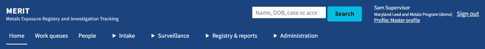
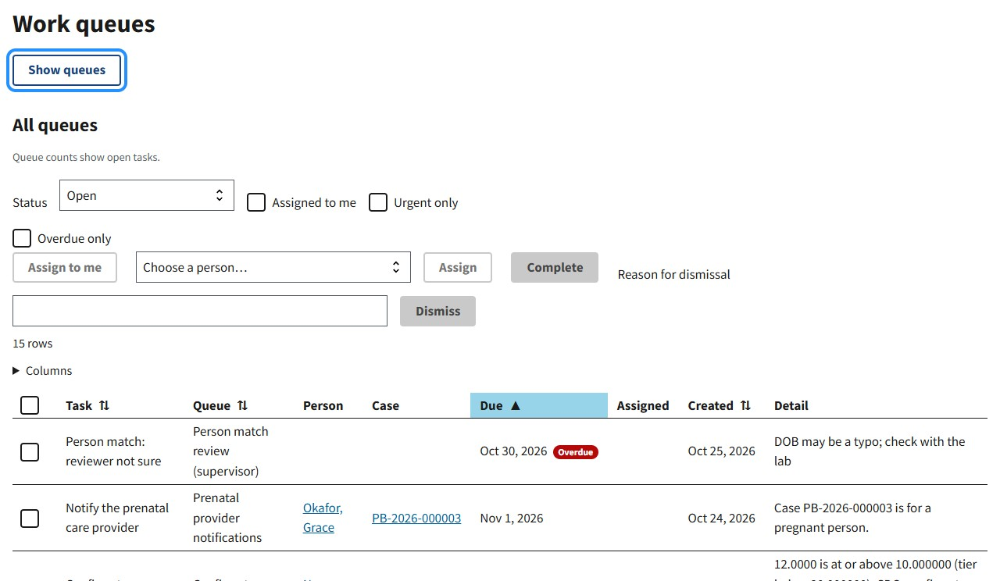

# Issue #137: horizontal navigation and contextual panels

## Implementation and rollout

The enhancement keeps global navigation horizontal. Home, Work queues and People are direct links; Intake,
Surveillance, Registry & reports, and Administration contain permission-filtered destinations. Empty groups are
omitted. Native `details`/`summary` disclosures expose expansion state and remain usable without JavaScript.
Only one group stays open; Escape returns focus, outside interactions dismiss it, and leaving a group by Tab
closes it without moving focus backward. The active group is visibly marked and named as the current section,
including after Angular route changes.

Work queues and Reports already had useful contextual navigation. Those lists are now collapsible, freeing
working width without adding another navigation column. Desktop toggle preferences persist separately for each
page. Narrow layouts start closed, can be expanded in place, and do not overwrite the desktop preference.
Escape and selecting a narrow-screen contextual link restore focus to its toggle. Escape inside workflow content
does not close the panel. Storage failures do not prevent operation. Held records, Results, Match Review and Map
receive no contextual panel.

The grouped layout and panel controls are gated by `Navigation:Enhanced`: **true in Development, false by default
elsewhere**. Set `Navigation__Enhanced=true` for evaluation. Disable it to return to the flat header and original
contextual lists. The shared link target-size correction and responsive header focus fix also apply to that
fallback. Server authorization and permission checks remain in effect in both layouts.

Default deployment rollout remains gated on the human/WAVE checks below. This PR addresses the implementation
portion of #137 and should not close the issue while those acceptance criteria remain open.





## Recommendations checked and measured

An authenticated administrator scan of the previous build at 1280 × 800 reproduced axe's WCAG 2.2 `target-size`
finding: the People link's safe space was 22.4 px high. Inline links overlapped the wrapped navigation row. Links
now have block boxes and minimum height, and enhanced header links/disclosures have at least 44 px height.
Header WCAG 2.2 scans pass for all three demo roles, including each expanded disclosure at 1280 and 320 px.
The fallback administrator header also passes its WCAG 2.2 scan.

Grouping only administration links was considered. It would leave most destinations individually exposed and
would not sufficiently reduce the tall expanded narrow-screen list. Four functional groups reduce the supervisor
and administrator to seven top-level choices, and the case manager to six. The labels and grouping are proposed
information architecture; they still need representative user evaluation.

| Measurement | Previous baseline from #134 | Enhanced preview |
| --- | --- | --- |
| Administrator header at 1280 px | About 178 px, two link rows | About 130 px, one navigation row |
| Supervisor header at 1280 px | About 156 px | About 130 px |
| Case-manager header at 1280 px | About 125 px | About 130 px |
| Supervisor expanded menu at 320 px | About 811 px | About 525 px with groups initially closed |
| Queue content width at 1280 px | 936 px with contextual list | 1248 px after hiding the list; 312 px recovered |

The narrow-screen figure does not imply all destinations are simultaneously visible; users expand the relevant
named group. Changing a disclosure does not alter filters or selection. Both desktop and narrow layouts keep all
authorized links in a consistent order. Browser tests verify the same 11/15/17 destinations across widths for the
case-manager/supervisor/administrator roles.

## Validation performed

- Angular production build: passed, including bundle budgets. .NET solution build: zero warnings/errors.
- Unit suite: 173 passed.
- SQL-backed integration suite: 76 passed and the previously observed session-renewal test failed; that test passed
  its isolated rerun. No navigation code changes were needed for that session-timing failure.
- Edge: 44 navigation/layout/keyboard/registry tests passed in the final affected-suite run. The earlier run also
  passed all 23 existing accessibility specs and 18 workflow-recovery specs. This is validation across targeted
  runs, not a claim of one all-green full-suite run.
- Chrome: all nine new navigation specs passed. Edge and Chrome share Chromium; Firefox/Safari were not tested.
- Role matrix in both browsers: 1440, 1280, 1024, 768, 640, 390 and 320 CSS-pixel widths; permitted destinations,
  empty groups, one desktop navigation row, target sizes, overflow, and header axe checks with `wcag22aa` included.
- Keyboard: native disclosure activation, Escape/outside dismissal, hidden navigation excluded from interaction,
  focus restoration in both directions across the 64em breakpoint, Razor/Angular active-section cues, panel
  collapse and persistence, storage-disabled behavior, and JavaScript-disabled server navigation.
- Actual browser zoom: 21 route/zoom checks in Edge and 21 in Chrome, each at 100%, 200% and 400%, covering Home,
  Work queues, Reports, Held records, Results, Match Review and Map. All passed with no page-wide overflow.
  The test used fresh isolated profiles and Chromium's real persisted zoom preference, then asserted the measured
  `devicePixelRatio` and layout width. At 200%/400%, Edge measured 627/313 CSS px and DPR 2/4; Chrome measured
  631/315 CSS px and DPR 2/4. Disclosure focus return and panel toggles were exercised at those zoom levels.
- Configuration off: verified flat administrator navigation with 17 links, zero header axe violations, and original
  visible queue navigation without collapse controls at tablet width.
- All three HTML user guides and their PDFs now explain the preview's navigation and contextual controls. Original
  screenshots remain identified as the default layout. New preview screenshots are above. Regenerated PDFs were
  rendered to contact sheets and inspected for clipping/layout (26, 13 and 9 pages).

Existing test maintenance was also necessary: the tenant county selector is now a fieldset rather than a single
input; date checks must exclude smaller badges and free-text task details; cluster navigation uses a populated
status filter rather than assuming the demo always has open clusters. Report/queue keyboard tests now explicitly
open their collapsed contextual lists before interacting with those links.

### Reproduce

Run the application in Development with demo SQL data. From `sourceCode/tests/e2e`:

```powershell
npx playwright test specs/navigation.spec.ts specs/layout.spec.ts specs/keyboard.spec.ts specs/registry-workflows.spec.ts
npx playwright test specs/accessibility.spec.ts specs/workflow-recovery.spec.ts
$env:MERIT_E2E_CHANNEL='chrome'
npx playwright test specs/navigation.spec.ts
node tools/navigation-zoom.cjs
$env:MERIT_E2E_CHANNEL='msedge'
node tools/navigation-zoom.cjs
```

The suite's global setup resets demo MFA and saves demo sessions. Run zoom checks after that setup, not concurrently
with another setup or test-results cleanup. Zoom evidence and isolated browser profiles are under the ignored
`test-results/navigation-zoom` directory. That tool fails rather than treating unapplied zoom as a successful test.
It is a Chromium diagnostic and uses no personal browser profiles.

## Remaining acceptance criteria before default rollout

- WAVE extension evaluation of the header in initial/expanded states and both contextual lists; resolve in-scope
  errors/contrast errors and disposition alerts. WAVE was not available in this browser automation environment.
- A spoken-output screen-reader evaluation (record NVDA/JAWS/Narrator and browser versions) on at least one Razor
  page and both Angular contextual-panel pages. Browser accessibility-tree inspection is not a substitute.
- Representative users, including keyboard and screen-reader users, compare the old header and preview. Record
  destination finding, task completion, errors and working-space usability. Include whether frequent use warrants
  keeping a contextual list expanded, and whether the group labels are understood without training.
- Evaluate additional browser engines and any deployment-specific accessibility scope as appropriate. Complete
  standards-based review of focus visibility/not-obscured behavior and remaining applicable WCAG/Section 508
  requirements; automated checks alone do not establish conformance.

These checks require human/external evaluation. They have not been marked complete or inferred from automation.
